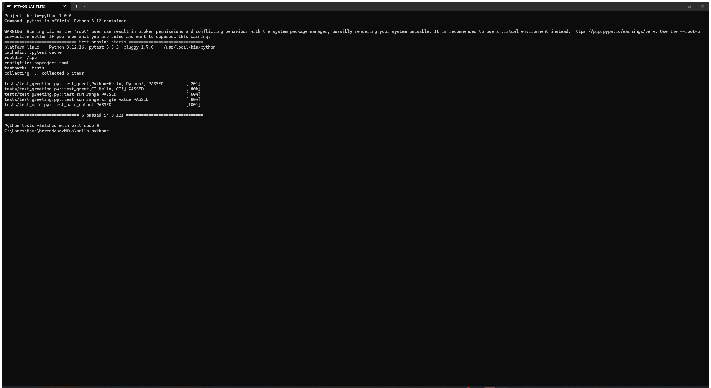

# Лабораторная работа: Python + PyInstaller + GitHub Releases

## Цель работы

Создать Python CLI, покрыть его тестами, настроить CI с Ruff/pytest и CD, который с помощью PyInstaller нативно собирает исполняемые файлы на Linux, macOS и Windows и публикует их в GitHub Release по семантическому тегу.

Задание выполнено по [инструкции преподавателя](https://github.com/rurewa/imfua/blob/main/content/DevOps/CI_CD/Pipelines/Python_PyInstaller_bin.md).

## Использованные технологии

- Python 3.12;
- pytest 8.3.3;
- Ruff 0.7.1;
- PyInstaller 6.11.0 в режиме `--onefile`;
- GitHub Actions с матрицей Linux/macOS/Windows;
- GitHub Releases и semantic versioning.

## Описание выполненных действий

1. Создан пакет `hello` с функциями `greet()` и `sum_range()`.
2. Реализовано CLI с версией, ОС, архитектурой, приветствием, суммой и аргументами командной строки.
3. Версия `1.0.0` синхронно задана в `pyproject.toml` и `hello/__init__.py`.
4. Добавлено 5 pytest-проверок функций и вывода CLI.
5. Настроены Ruff lint/format и pytest в CI.
6. Настроена матричная нативная PyInstaller-сборка на трёх ОС.
7. Настроена публикация трёх бинарников через `softprops/action-gh-release` по тегу `v*`.
8. Локально проверены Ruff, pytest, Linux PyInstaller-бинарник и его запуск.

PyInstaller не является кросс-компилятором, поэтому каждый файл создаётся на runner соответствующей ОС.

## Структура проекта

```text
hello-python/
├── .github/workflows/ci.yml
├── hello/
│   ├── __init__.py
│   └── greeting.py
├── screenshots/
│   ├── 01-tests.png
│   ├── 02-github-actions.png
│   └── 03-release.png
├── tests/
│   ├── test_greeting.py
│   └── test_main.py
├── .gitignore
├── main.py
├── pyproject.toml
├── requirements.txt
└── README.md
```

## Команды запуска

```bash
python -m venv .venv
python -m pip install -r requirements.txt
python main.py demo
```

Сборка бинарника для текущей ОС:

```bash
python -m PyInstaller --onefile --name hello-python main.py
```

Ожидаемый вывод:

```text
hello-python version 1.0.0
Hello from Python! 🐍📦
OS: <текущая ОС>
Arch: <архитектура>
Hello, GitHub!
Sum 1..10 = 55
```

## Тестирование и проверка

```bash
ruff check .
ruff format --check .
python -m pytest -v
```

Локальный результат: `5 passed`; Linux-бинарник PyInstaller успешно запущен и вывел версию `1.0.0`.

## Настройка GitHub Actions

Workflow [Python CI/CD](https://github.com/Andrey76546/hello-python/actions/workflows/ci.yml) запускается при push в `main`, pull request, вручную и при push тегов `v*`.

- `Lint & Test` — Python 3.12, pip cache, Ruff и pytest;
- release matrix — `ubuntu-latest`, `macos-14` (Apple Silicon), `windows-latest`;
- PyInstaller `--onefile` создаёт отдельный бинарник на каждом runner;
- `softprops/action-gh-release@v3` публикует файлы в Release.

Все запуски: [GitHub Actions](https://github.com/Andrey76546/hello-python/actions).

## Результаты выполнения

- 5 тестов успешно проходят;
- Ruff не находит ошибок форматирования или линтинга;
- опубликована версия `v1.0.0`;
- Release содержит Linux x64, macOS ARM64 и Windows x64 бинарники.

Release: [v1.0.0](https://github.com/Andrey76546/hello-python/releases/tag/v1.0.0).

## Настоящие скриншоты



Снимок подтверждает реальный запуск pytest в Python 3.12: 5 тестов пройдены.


Снимок подтверждает успешные тесты и три нативные PyInstaller-сборки в GitHub Actions.


Снимок подтверждает опубликованный Release `v1.0.0` с тремя исполняемыми файлами.

## Скачивание готовых файлов

- [Linux x64](https://github.com/Andrey76546/hello-python/releases/download/v1.0.0/hello-python-linux-x64)
- [macOS ARM64](https://github.com/Andrey76546/hello-python/releases/download/v1.0.0/hello-python-macos-arm64)
- [Windows x64](https://github.com/Andrey76546/hello-python/releases/download/v1.0.0/hello-python-windows-x64.exe)

## Вывод

Реализован полный CI/CD-цикл Python CLI: качество и тесты проверяются при каждом изменении, а семантический тег запускает нативную сборку PyInstaller на трёх ОС и публикацию готовых файлов в GitHub Releases.

